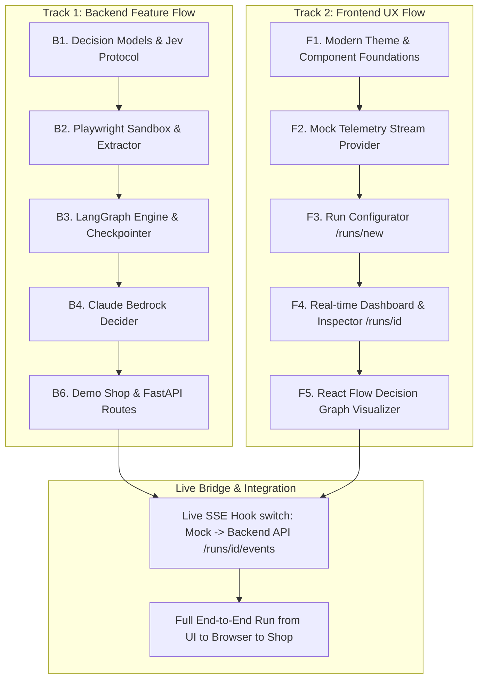

# QAgent Parallel Tracks: Backend Feature Flow vs Frontend UX Flow

This document defines the decoupled separation between:
- **Track 1: Backend Feature Flow** (Agentic architecture, Jev decision loop, Playwright sandbox, LangGraph state engine, Bedrock Claude reasoning, and Playbooks).
- **Track 2: Frontend UX Flow** (Premium user experience, real-time telemetry streaming, interactive decision graphs with React Flow, live step timelines, screenshot inspectors, and comparative run analytics).

---

## Strategic Separation & Principles

| Dimension | Backend Feature Flow (Engine & Robustness) | Frontend UX Flow (Experience & Control) |
|---|---|---|
| **Primary Goal** | Flawless automation, fast decision latency (<400ms), rock-solid browser execution, and strict gating tiers. | Stunning visual aesthetics, instant feedback, real-time observability into the agent's thought process, and intuitive test orchestration. |
| **Directory Scope** | `backend/qagent/`, `demo-shop/`, `backend/tests/` | `frontend/src/` (`app/`, `components/`, `lib/`, `hooks/`) |
| **Tech Stack** | Python 3.11+, Playwright, LangGraph, FastAPI, Pydantic, HTTPX, SQLite, Pytest | Next.js 16 (App Router), TypeScript, Tailwind CSS, `@xyflow/react`, Lucide Icons |
| **Mocking & Independence** | Implements mock/stub deciders & simulated browser runs so backend tests without UI. | Uses simulated SSE event mock streams so frontend UX design & polish can proceed at full speed without waiting for backend runs. |

---

## Shared Contract Boundary (The Interface Bridge)

Both flows communicate exclusively via two clean interfaces:

```
┌────────────────────────────────────────────────────────┐
│                   REST & SSE CONTRACT                  │
│                                                        │
│  1. POST /runs            -> Launch QA run             │
│  2. GET  /runs/{id}       -> Retrieve run summary      │
│  3. GET  /runs/{id}/events-> SSE Real-time telemetry   │
│  4. POST /runs/{id}/stop  -> Force stop run            │
│  5. GET  /health          -> Jev & Bedrock status      │
└────────────────────────────────────────────────────────┘
                           ▲
                           │
       ┌───────────────────┴───────────────────┐
       │                                       │
┌───────────────┐                       ┌───────────────┐
│ Track 1:      │                       │ Track 2:      │
│ Backend Flow  │                       │ Frontend Flow │
│ (Features)    │                       │ (UX-First)    │
└───────────────┘                       └───────────────┘
```

### Standard SSE Event Types
```typescript
export type QAgentEventType =
  | "RUN_STARTED"        // { run_id, target_url, playbook, mode, timestamp }
  | "STEP_OBSERVED"     // { step_idx, screenshot_url, url, candidates_count }
  | "DECISION_MADE"     // { step_idx, decider: "jev"|"claude", action, confidence, latency_ms, cost }
  | "GATE_TRIGGERED"    // { step_idx, tier: "AUTO"|"ESCALATE"|"STOP", reason }
  | "ACTION_EXECUTED"   // { step_idx, action_id, locator, duration_ms, status }
  | "VERIFICATION_STEP" // { step_idx, assertion, passed: boolean, message }
  | "RUN_FINISHED"      // { run_id, outcome: "PASSED"|"FAILED"|"STOPPED", total_steps, total_cost, duration_s }
  | "RUN_ERROR";        // { run_id, step_idx, error_message, stack_trace }
```

---

## Track 1: Backend Feature Flow (Step-by-Step)

Focused on capability, speed, and correctness:

### B1. Decision Models & Jev Protocol (`backend/qagent/decision/`)
- Pydantic models: `CandidateAction`, `DecisionResult`, `ConfidenceTier` (`AUTO`, `ESCALATE`, `STOP`).
- `JevDecider`: Async HTTP client targeting `https://api.typesafe.ai/v1/systemone` (`jev-1.13.0`), 429/529 exponential backoffs, concurrency semaphore (`JEV_MAX_CONCURRENCY=4`), latency instrumentation, and tape recording.
- Stubs: `StubDecider`, `RecordingDecider`, `ReplayDecider`.

### B2. Browser Layer Sandbox & DOM Extractor (`backend/qagent/browser/`)
- `sandbox.py`: Playwright context, headless/headed toggles, 1280x800 viewport, frozen time, and request interception.
- `extractor.py`: DOM traversal extracting actionable candidates (buttons, inputs, links, dropdowns), assigning compact numeric IDs (1–40), bounding rects, and semantic text.
- `executor.py`: Maps selected ID back to locator, executes clicks/fills, takes step screenshots saved to `runs/{run_id}/screenshots/`.

### B3. LangGraph Orchestration Engine (`backend/qagent/engine/`)
- State Graph: `plan` → `observe` → `decide` → `gate` → `act` → `verify` → (`loop` | `finish` | `escalate`) → `report`.
- SQLite checkpointer (`runs/qagent.db`) for run resumption and auditing.
- Safety budgets: Max step budget (e.g. 25 steps) and timeout budget (e.g. 180s).
- Event bus (`asyncio.Queue`) publishing all state transitions to SSE.

### B4. Claude Reasoning Layer (`backend/qagent/decision/claude.py`)
- Direct HTTPX Bearer token client to AWS Bedrock Converse endpoint (`us.anthropic.claude-sonnet-4-20250514-v1:0`).
- Forced tool-use pattern enforcing structured JSON output for complex flow recovery and deep verification.

### B5. Playbook Engine (`backend/qagent/playbooks/`)
- YAML playbook loader & Pydantic validator (`checkout-flow.yaml`).
- Pre-conditions, target assertions, and formula evaluations.

### B6. FastAPI Server & Demo Shop (`backend/qagent/api/` & `demo-shop/`)
- API endpoints: `/runs`, `/runs/{id}`, `/runs/{id}/events`, `/runs/{id}/stop`, `/health`.
- Demo shop: FastAPI + Jinja2 with 4 togglable bugs (`DEMO_BUGS=1,2,3,4`) and `POST /__reset`.

---

## Track 2: Frontend UX Flow (Experience & Interface-First)

Focused on visual excellence, fluidity, and state-of-the-art telemetry:

### F1. Design System & Theme Foundations (`frontend/src/`)
- Modern dark mode aesthetic: Deep slate backgrounds (`#090D16`), vibrant accents (cyan `#06B6D4`, violet `#8B5CF6`, emerald `#10B981`), refined typography (`Inter` / `Outfit`).
- Glassmorphism panels, crisp borders (`border-white/10`), subtle glow effects, and micro-interactions.
- Reusable components: `Button`, `Badge`, `Card`, `StatusPill`, `MetricsCard`, `Tabs`.

### F2. Mock Event Stream Provider (`frontend/src/lib/mock-stream.ts`)
- Embedded mock telemetry emitter simulating a complete test run (cart checkout flow with decision branching, screenshots, confidence tier changes, and bug detection).
- Allows frontend UX to be iterated, animated, and styled immediately without requiring backend dev servers running.

### F3. Run Creator Page (`/runs/new` & `frontend/src/app/runs/new/page.tsx`)
- Target URL input with pre-filled quick buttons (e.g. "Demo Shop Local", "Demo Shop with Bug #2").
- Interactive Playbook picker with YAML preview and step counter.
- Execution Mode selector:
  - **High-Speed Jev** (Low latency, ~400ms decisions)
  - **Claude Baseline** (Full reasoning)
  - **Dual-Gated Hybrid** (Jev auto-pilot + Claude escalation)
- Budget limit controls (Max steps, timeout in seconds).

### F4. Live Execution Dashboard (`/runs/[id]` & `frontend/src/app/runs/[id]/page.tsx`)
- **Top Metrics Strip**: Live status badge, step counter, elapsed time, Jev vs Claude decision split, total estimated cost ($), and average latency (ms).
- **Control Bar**: Pause, Stop, Step-by-Step manual advance, and Download Run Tape buttons.
- **Center Split Workspace**:
  - **Left / Center**: Live Screenshot Inspector with overlaid bounding boxes and highlighted candidate action.
  - **Right**: Real-time Step Timeline with collapsible step details, raw observation JSON, and reasoning logs.

### F5. Interactive Decision Flowchart (`@xyflow/react`)
- Visual node graph rendering the live LangGraph state transitions:
  `Plan` ➔ `Observe` ➔ `Decide (Jev)` ➔ `Gate (Auto/Escalate)` ➔ `Act` ➔ `Verify`
- Active node pulse animations, edge flows showing decision transitions, and confidence badges.

### F6. Run Comparison & Analytics View (`/compare` & `/runs/[id]/replay`)
- Side-by-side run viewer comparing Jev-Only vs Dual-Gated vs Claude Baseline runs.
- Latency distribution graphs, step counts, and bug detection accuracy diffs.

---

## Autonomous Parallel Workflow


